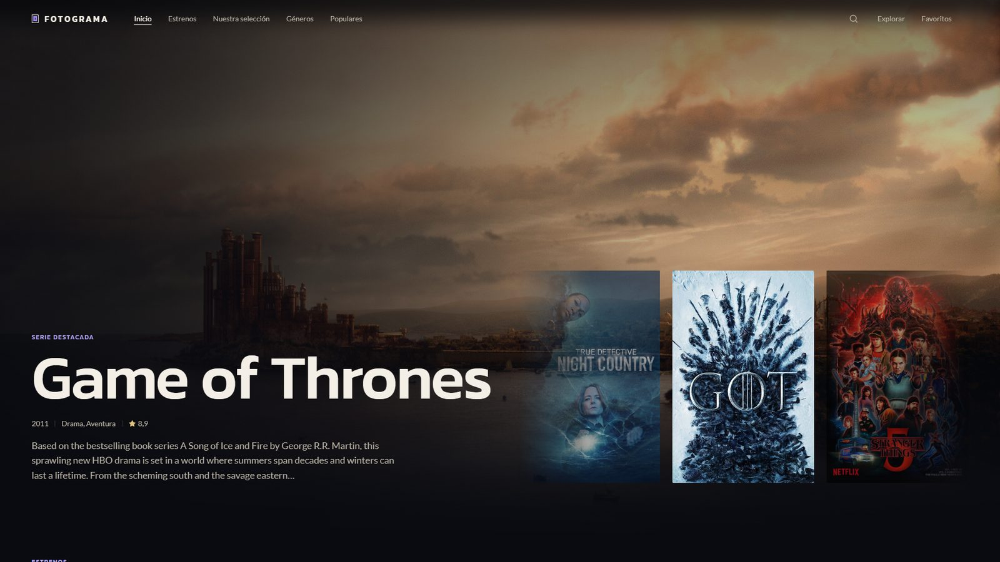
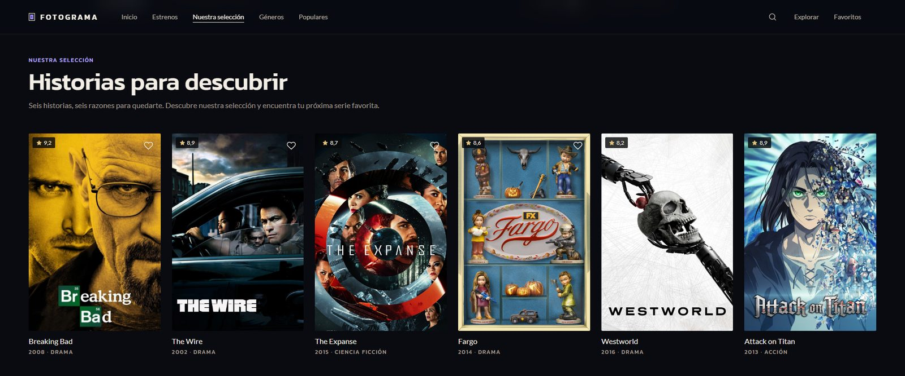
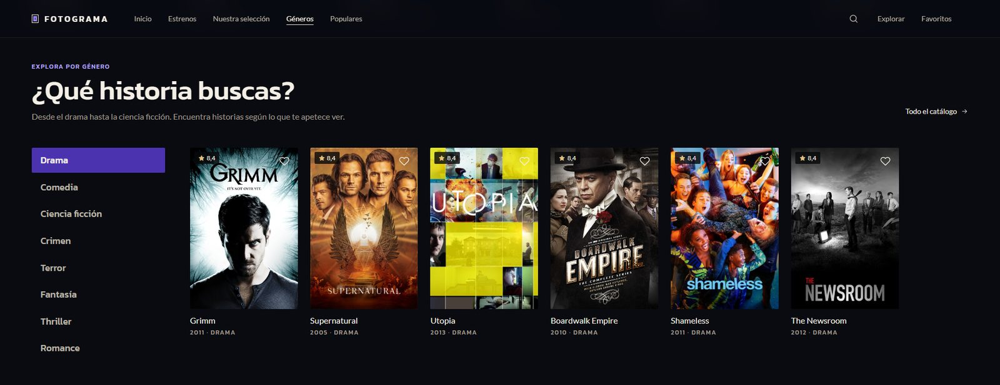
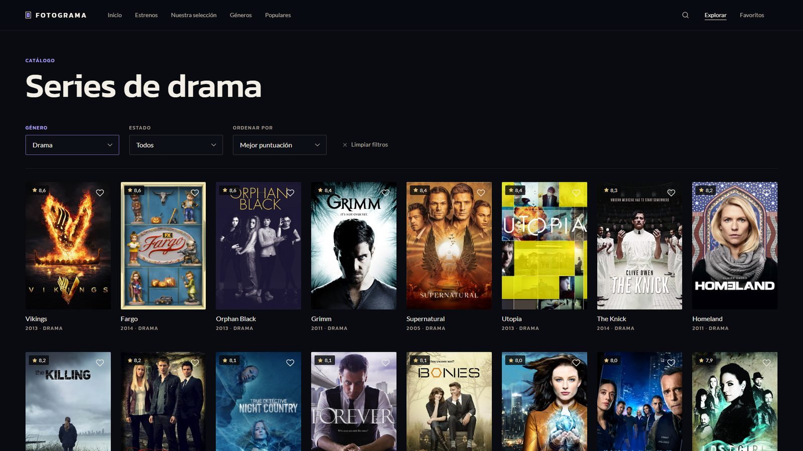
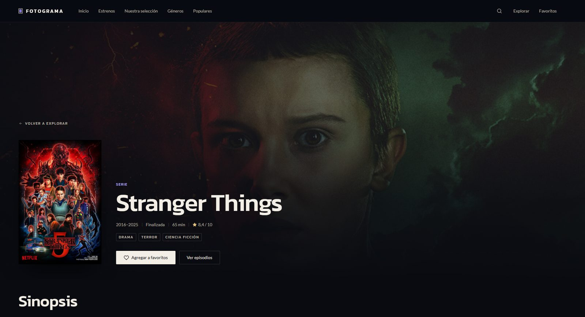
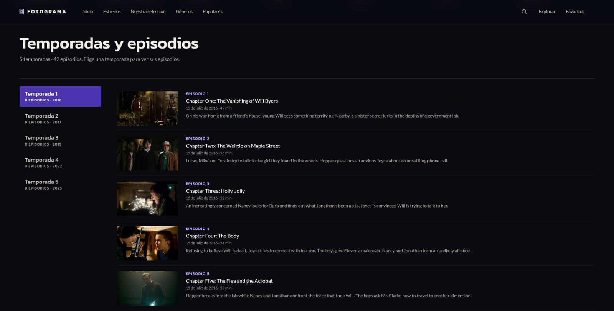
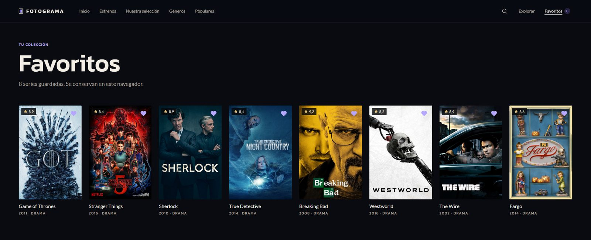
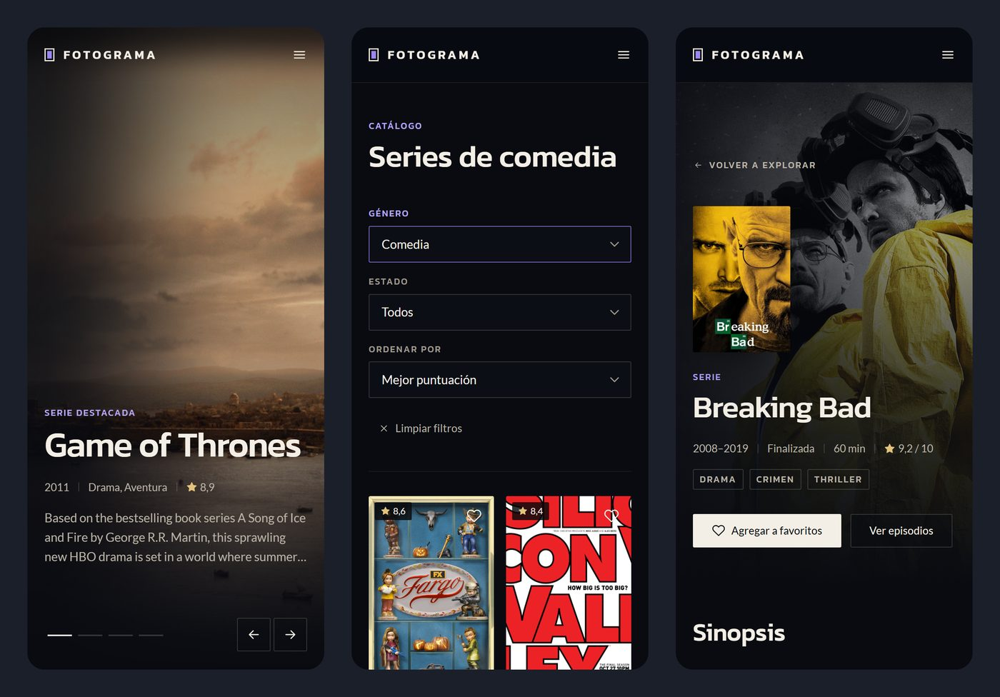

<h1 align="center">Fotograma</h1>

<p align="center">
  <strong>Tu guía para descubrir series.</strong><br>
  Mira qué se estrena hoy, encuentra tu próxima serie favorita y guárdala para no perderla de vista.
</p>

<p align="center">
  
</p>

<p align="center">
  <a href="https://lemond01.github.io/series-fotograma/"><strong>Visitar Fotograma</strong></a>
  &nbsp;·&nbsp;
  <a href="https://github.com/Lemond01/series-fotograma">Ver el repositorio</a>
</p>

---

## Qué es Fotograma

Fotograma es una guía para descubrir series de televisión. Reúne el catálogo de [TVmaze](https://www.tvmaze.com/), con miles de series reales, y lo presenta como una plataforma de streaming: pósteres grandes, portadas que se mueven y todo a uno o dos clics.

Aquí no se reproducen episodios. Fotograma te ayuda a decidir qué ver: de qué trata cada serie, cuántas temporadas tiene, cómo la ha puntuado el público y qué se estrena hoy.

---

## Un recorrido por Fotograma

### Una portada con vida propia

Cada visita empieza con una serie destacada a pantalla completa. Las series van cambiando solas y, en pantallas grandes, sus pósteres se deslizan a un lado para que sepas cuál viene después. Basta un clic en el póster o en el título para abrir su ficha.

### Una selección para empezar

Seis series elegidas a mano para quien no sabe por dónde empezar. Es una selección propia, no un ranking.

<p align="center">
  
</p>

### ¿Qué historia buscas?

Elige un género (drama, comedia, ciencia ficción, crimen, terror, fantasía, thriller o romance) y al instante aparecen algunas de sus series mejor valoradas. En la misma portada te esperan también las series más populares y los estrenos del día, con la hora ajustada a tu zona.

<p align="center">
  
</p>

### Todo el catálogo a tu alcance

Recorre el catálogo completo, filtra por género o por estado (en emisión, finalizada…) y ordena por puntuación, nombre o año. ¿Ya sabes qué buscas? El buscador está en el menú, en cualquier página.

<p align="center">
  
</p>

### Cada serie, a fondo

Cada serie tiene su propia ficha: póster, sinopsis, géneros, años de emisión, duración y puntuación. Sus temporadas se recorren una a una, con cada episodio, su fecha de estreno y un pequeño resumen.

<p align="center">
  
</p>

<p align="center">
  
</p>

### Tus favoritas, siempre a mano

Pulsa el corazón en cualquier serie y quedará en tu colección. Sin registrarte, y sigue ahí aunque cierres el navegador.

<p align="center">
  
</p>

### También en tu móvil

Fotograma se adapta a cualquier pantalla: el menú se recoge, las tarjetas se reorganizan y todo sigue a mano con el pulgar.

<p align="center">
  
</p>

---

## Lo que puedes hacer

- **Descubrir** series nuevas desde la portada, la selección y los géneros.
- **Ver qué se estrena hoy** en las plataformas digitales.
- **Explorar** el catálogo completo, con filtros y distintos órdenes.
- **Buscar** cualquier serie por su título.
- **Conocer cada serie a fondo**, con sus temporadas y episodios.
- **Guardar tus favoritas** sin crear una cuenta.
- **Usarlo en cualquier dispositivo**, del móvil a una pantalla grande.

---

## Pensado para disfrutarlo

- **Aire de cine:** fondos oscuros, acentos violeta y tipografías con carácter.
- **Los pósteres mandan:** las imágenes de cada serie guían el recorrido.
- **Movimiento suave:** la portada cambia sola y las transiciones acompañan sin distraer.
- **Siempre claro:** si una búsqueda no encuentra nada o falla la conexión, Fotograma te lo dice y te deja volver a intentarlo.

---

## Créditos

- **Datos:** [TVmaze](https://www.tvmaze.com/). Los datos de su [API](https://www.tvmaze.com/api) están bajo licencia [CC BY-SA 4.0](https://creativecommons.org/licenses/by-sa/4.0/).
- **Imágenes:** los pósteres y fotogramas los sirve TVmaze y pertenecen a sus respectivos titulares. La licencia anterior se refiere a los datos, y este proyecto no posee derechos sobre las imágenes.
- **Tipografías:** [Kanit](https://fonts.google.com/specimen/Kanit) y [Lato](https://fonts.google.com/specimen/Lato), de Google Fonts.
- **Axios:** licencia MIT, incluida en `src/vendor/axios/LICENSE`.

---

<details>
<summary><strong>Ver Fotograma en tu equipo</strong></summary>

<br>

Fotograma está hecho con HTML, Sass y JavaScript, y obtiene sus datos de TVmaze. Para abrirlo en tu equipo:

```bash
npm install
npm run build
python -m http.server 8000
```

Después abre <http://localhost:8000>. También funciona con la extensión Live Server de VS Code. Necesita un servidor local porque el proyecto usa módulos de JavaScript.

</details>
