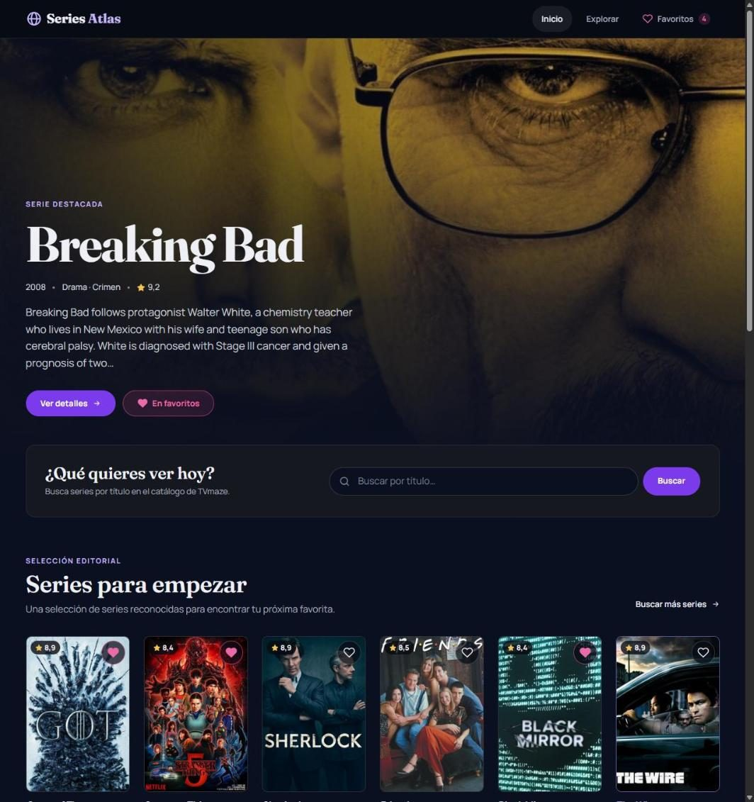
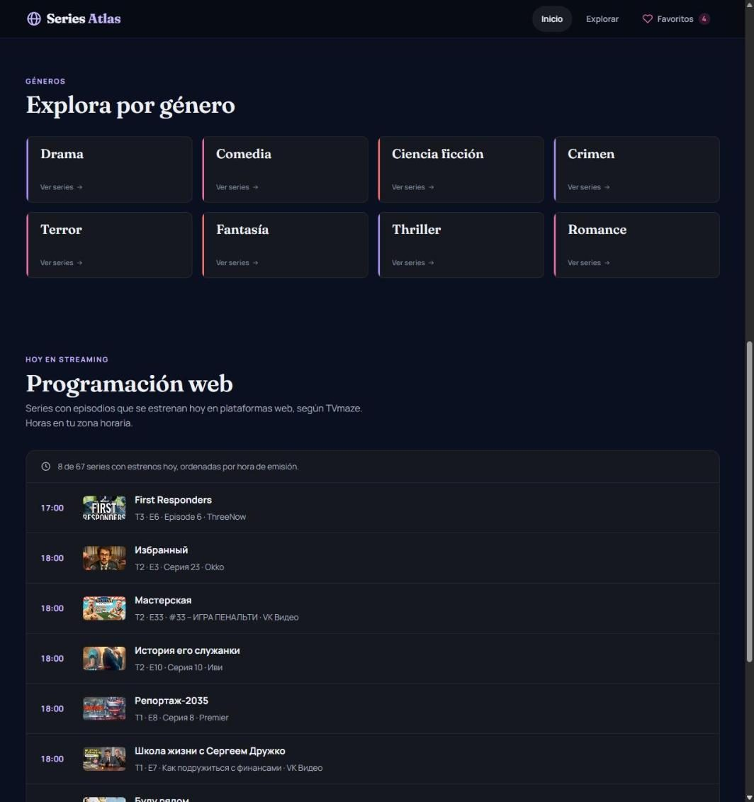
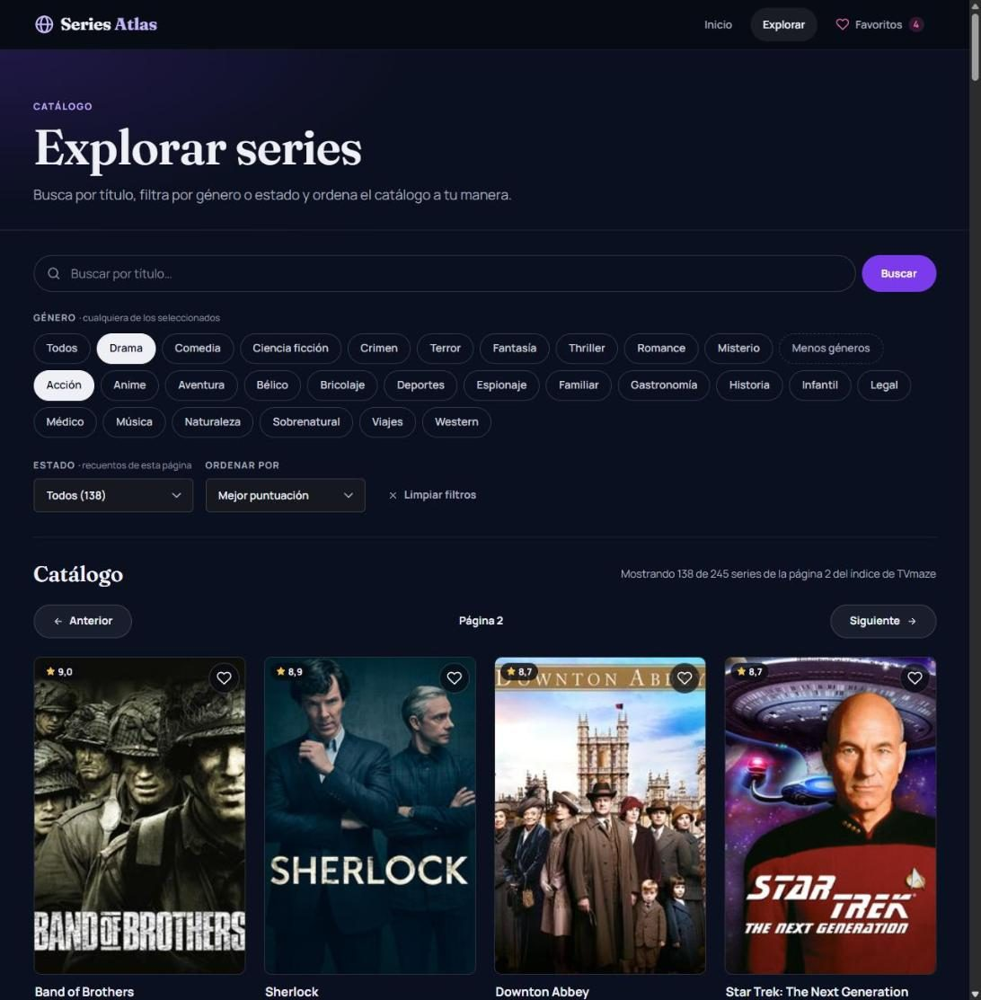
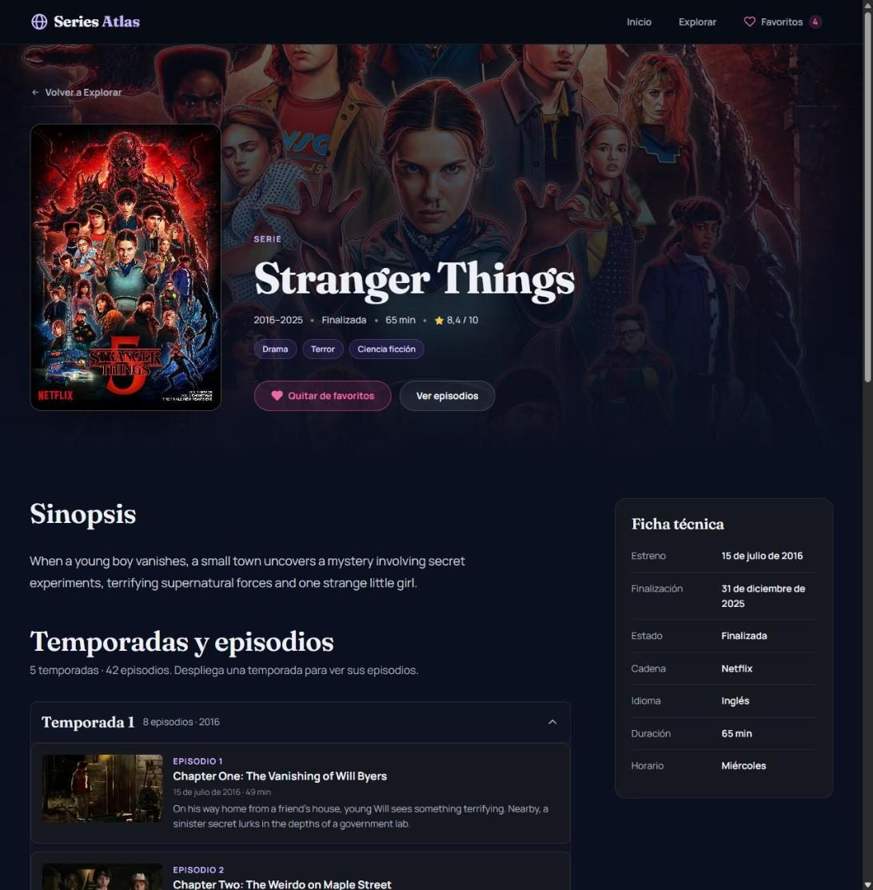
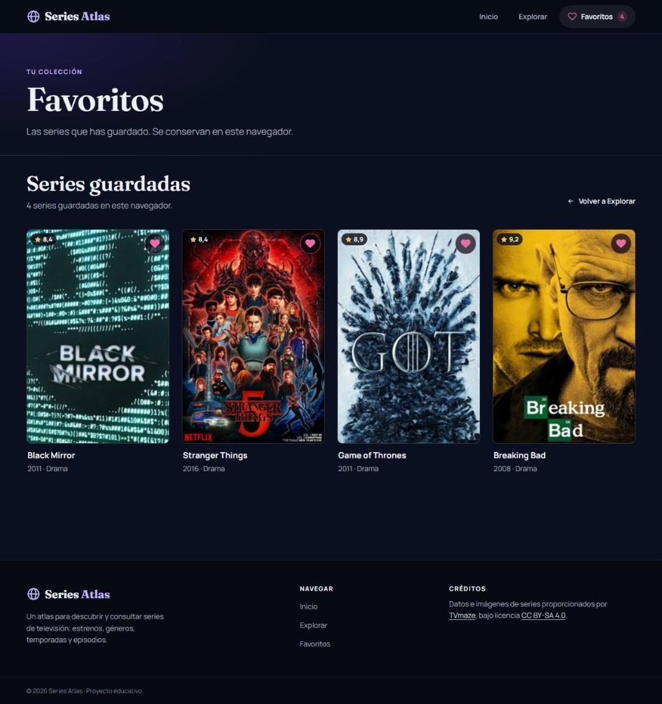
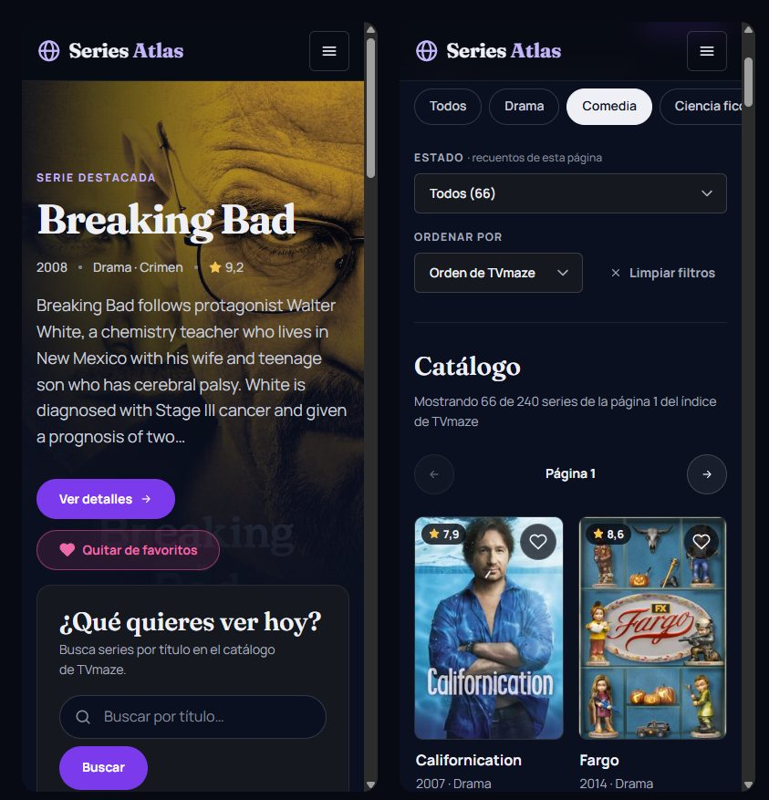

<h1 align="center">Series Atlas</h1>

<p align="center">
  <strong>Un atlas para descubrir y consultar series de televisión.</strong><br>
  Busca una serie, recorre el catálogo, revisa sus temporadas y guarda tus favoritas.
</p>

<p align="center">
  
</p>

<p align="center">
  <a href="https://github.com/Lemond01/series-atlas"><strong>Ver el repositorio</strong></a>
  &nbsp;·&nbsp;
  Demo: próximamente
</p>

---

## Sobre el proyecto

Series Atlas es una aplicación web que desarrollé para descubrir series y consultar su información: sinopsis, géneros, puntuación, temporadas y episodios. Todos los datos son reales y llegan de la API pública de TVmaze.

Quería construir un sitio completo sin frameworks. Mi objetivo era que se sintiera como una plataforma de series, que funcionara bien en el móvil y que resolviera los casos difíciles: búsquedas sin resultados, errores de conexión o datos que faltan.

---

## Explora Series Atlas

### Inicio

Una serie destacada, un buscador, una selección de series para empezar, accesos directos por género y los estrenos web del día.

<p align="center">
  
</p>

### Catálogo, búsqueda y filtros

Recorro el catálogo de TVmaze página a página o busco por título. Los resultados se pueden filtrar por uno o varios géneros y por estado, y ordenar por puntuación, nombre o año.

<p align="center">
  
</p>

### Detalle, temporadas y episodios

Cada serie tiene su ficha con póster, sinopsis, géneros y datos técnicos. Los episodios aparecen agrupados por temporada, en secciones que se abren y se cierran.

<p align="center">
  
</p>

### Favoritos

Guardo cualquier serie con el corazón y la encuentro después en mi colección, aunque cierre el navegador.

<p align="center">
  
</p>

### En el móvil

<p align="center">
  
</p>

---

## Funcionalidades

- **Catálogo** con el índice completo de TVmaze.
- **Paginación** para recorrerlo página a página.
- **Búsqueda** por título mientras escribo.
- **Filtros** por género y estado, y **orden** por puntuación, nombre o año.
- **Ficha de cada serie** con sinopsis, datos técnicos, temporadas y episodios.
- **Favoritos** guardados en el navegador, sin registro.
- **Diseño adaptable** del móvil al escritorio.

---

## Diseño y experiencia

- **Estética cinematográfica:** fondos en azul noche, acentos violeta y magenta, y títulos con una tipografía editorial.
- **Los pósteres como protagonistas:** las imágenes de cada serie guían la navegación.
- **Navegación sencilla:** tres páginas (Inicio, Explorar y Detalle) y acceso a Favoritos desde cualquier lugar.
- **Responsive:** en el móvil, el menú se recoge, las tarjetas se reorganizan y los controles se adaptan a la pantalla.
- **Estados cuidados:** marcadores de carga, mensajes claros cuando no hay resultados y opción de reintentar si algo falla.

---

## Tecnologías utilizadas

**HTML5** · **Sass / SCSS** · **JavaScript Vanilla** · **Axios** · **TVmaze API** · **LocalStorage** · **Git y GitHub**

---

## Prueba Series Atlas

La demo todavía no está publicada. Cuando esté disponible en GitHub Pages, dejaré aquí el enlace.

---

## Créditos

- **Datos:** [TVmaze](https://www.tvmaze.com/). Los datos de su [API](https://www.tvmaze.com/api) están bajo licencia [CC BY-SA 4.0](https://creativecommons.org/licenses/by-sa/4.0/).
- **Imágenes:** los pósteres y fotogramas los sirve TVmaze y pertenecen a sus respectivos titulares. La licencia anterior se refiere a los datos, y este proyecto no posee derechos sobre las imágenes.
- **Tipografías:** [Fraunces](https://fonts.google.com/specimen/Fraunces) y [Manrope](https://fonts.google.com/specimen/Manrope), de Google Fonts.
- **Axios:** licencia MIT, incluida en `src/vendor/axios/LICENSE`.

---

## Ejecución local

```bash
npm install
npm run build
python -m http.server 8000
```

Después abro <http://localhost:8000>. También funciona con la extensión Live Server de VS Code. Necesita un servidor local porque el proyecto usa módulos de JavaScript.
